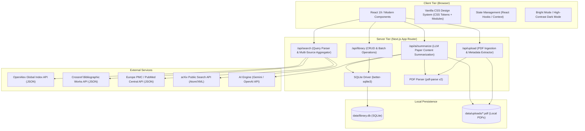
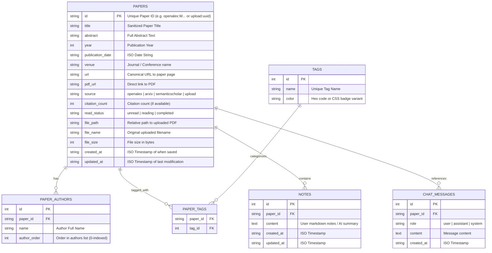
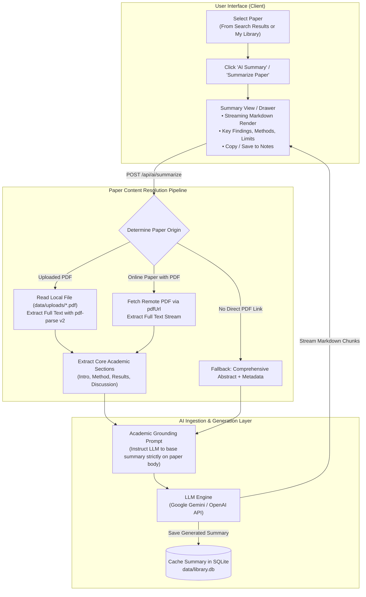

# AI Research Assistant — Detailed Technical Implementation Plan

> **Companion Document**: For the executive overview, see [PLAN_SUMMARY.md](file:///Users/rajeevgoyal/Codes/ASE/PLAN_SUMMARY.md).  
> **Target Audience**: AI Coding Agents & Engineers implementing the system.

---

## 1. System Architecture & Rationale

### 1.1 Architectural Topology



### 1.2 Technology Selection & Rationale

| Layer | Technology | Decision Rationale & Alternatives Considered |
|---|---|---|
| **Full-Stack Framework** | **Next.js (App Router, TypeScript)** | **Chosen**: Single runtime for UI, API proxying, and local DB operations. Completely avoids Cross-Origin (CORS) blocks from external APIs like arXiv. Strict TypeScript type sharing between backend and UI.<br/>*Alternative rejected*: FastAPI + Vite React requires running two processes and managing multi-service dev environments. |
| **Styling** | **Vanilla CSS + CSS Modules** | **Chosen**: In accordance with project design principles, Vanilla CSS delivers maximum control without Tailwind abstractions. Uses CSS variables for theme tokens (high-contrast dark mode for low brightness, bright mode, glassmorphism, accent glows), high performance, zero build-step overhead. |
| **Local Database** | **SQLite (via `better-sqlite3`)** | **Chosen**: Self-contained, zero-configuration, file-based database (`data/library.db`). Synchronous binding eliminates async race conditions; guarantees persistence across server restarts and page refreshes. Supports atomic batch operations.<br/>*Alternative rejected*: Browser `localStorage`/`IndexedDB` does not allow server-side processing or easy data export; PostgreSQL requires installing external services. |
| **PDF Extraction** | **`pdf-parse` v2 + Text Heuristics** | **Chosen**: Robust parsing of academic PDF structures; reliably extracts titles, author blocks, publication years, and abstract sections from raw PDF text streams. |
| **Search Providers** | **OpenAlex + Crossref + Europe PMC + arXiv** | **Chosen**: OpenAlex & Crossref provide 250M+ indexed works with exact conference/journal matching without rate limits; Europe PMC recovers publisher-restricted abstracts (Nature, Springer, Elsevier); arXiv provides pre-prints. |
| **AI LLM Integration** | **Google Gemini API / OpenAI SDK** | **Chosen**: High token context window suitable for ingesting full paper contents and PDFs; streaming support for real-time conversational responses. |

---

## 2. Database Schema (SQLite)

The local database file resides at `data/library.db`. Database migrations are handled automatically on startup by initializing tables if they do not exist.



---

## 3. Architecture Specification: Task 4 — Summarize Papers with an LLM

### 3.1 Requirement Definition
> *"The user should be able to select a paper and ask an LLM to generate a summary of the paper. The summary should be based on the content of the selected paper rather than only its title or metadata."*

### 3.2 Task 4 Architecture Diagram



### 3.3 Content Grounding Pipeline
To guarantee that the summary is **based on the content of the paper rather than only its title or metadata**:
1. **Uploaded PDF Papers**:
   - The server inspects `paper.filePath` (stored in `data/uploads/${fileId}.pdf`).
   - Uses `pdf-parse` v2 (`PDFParse`) to extract the entire text body of the paper (up to 40,000 tokens).
   - Identifies major structural sections (Introduction, Methodology, Experiments / Results, Conclusion).
2. **Online Preprints & Open Access Papers (arXiv / OpenAlex)**:
   - If `paper.pdfUrl` is available, the server downloads and parses the PDF text.
   - If a direct PDF is inaccessible or rate-limited, the system falls back to the full abstract text and any available full-text snippet sections, with an explicit UI indicator to the researcher.
3. **Structured Summary Prompting**:
   The LLM prompt is engineered to extract content-specific technical substance:
   - **Research Objective & Motivation**: The specific gap the paper addresses.
   - **Technical Architecture & Methodology**: How the authors implemented their solution (algorithms, datasets, model architecture).
   - **Quantitative Results & Key Findings**: Benchmark scores, accuracy numbers, performance metrics from the paper body.
   - **Limitations & Future Directions**: Stated constraints and failure modes identified by the authors.

---

## 4. REST API Route Specifications

### 4.1 Search Endpoint
- **Path**: `GET /api/search`
- **Query Params**: `q`, `page`, `limit`, `sortBy`, `year`, `provider`

### 4.2 Local Library Endpoints
- **Path**: `GET /api/library`: Returns all saved papers.
- **Path**: `POST /api/library`: Supports single paper and batch saving (`{ papers: [...] }`).
- **Path**: `DELETE /api/library`: Removes paper by `?id=...`.

### 4.3 PDF Paper Upload & Extraction Endpoint
- **Path**: `POST /api/upload`: Multipart PDF upload; extracts metadata and stores PDF binary.
- **Path**: `GET /api/uploads/[filename]`: Serves stored PDFs for inline reading.

### 4.4 LLM Summarization Endpoint (Task 4)
- **Path**: `POST /api/ai/summarize`
- **Payload**:
  ```json
  {
    "paperId": "openalex:W4384561707",
    "paper": { ... },
    "focus": "general"
  }
  ```
- **Processing**:
  1. Resolves paper content (local PDF text, remote PDF stream, or comprehensive abstract).
  2. Constructs content-grounded academic prompt.
  3. Calls LLM (streaming response or structured JSON/Markdown).
  4. Stores summary in SQLite `notes` table or paper cache for instant offline retrieval.

---

## 5. UI/UX Design System & Layout Architecture

### 5.1 Design Tokens (Vanilla CSS Architecture)
Located in `src/app/globals.css`:
- **Dark Mode (High Contrast for low brightness readability)**:
  - Background: `#090d16`, Surface: `#121829`, Elevated: `#1a233a`
  - Text: `#ffffff` (primary), `#e2e8f0` (secondary), `#cbd5e1` (muted)
  - Borders: `rgba(255, 255, 255, 0.16)`
- **Bright Mode**:
  - Background: `#f8fafc`, Surface: `#ffffff`, Elevated: `#f1f5f9`
  - Text: `#0f172a` (primary), `#334155` (secondary), `#475569` (muted)
  - Borders: `#e2e8f0`

---

## 6. Implementation Checklist & Phased Execution

```
[x] Phase 1: Foundation & Project Scaffolding
    [x] Initialize Next.js project with TypeScript in current directory
    [x] Set up Vanilla CSS tokens, reset, typography, and theme variables
    [x] Configure SQLite database helper with schema auto-migration (library.db)

[x] Phase 2: Academic Paper Search Engine & Multi-Select Save
    [x] Implement OpenAlex multi-provider search with arXiv fallback
    [x] Implement Crossref precision title resolution and publisher figure filtering
    [x] Build SearchBar, FilterBar, and PaperCard components with loading skeletons
    [x] Implement multi-select checkboxes on paper cards and batch save toolbar
    [x] Implement high-contrast dark mode and bright mode switcher with persistence
    [x] Prioritize papers with abstracts and relegate abstract-less papers to bottom

[x] Phase 3: Upload PDF Papers & Metadata Extraction
    [x] Install pdf-parse v2 and configure PDF extraction pipeline
    [x] Create upload storage directory (data/uploads/)
    [x] Implement metadata extraction pipeline (Title, Authors, Year, Abstract)
    [x] Create POST /api/upload and GET /api/uploads/[filename]
    [x] Build Drag-and-Drop UploadModal component
    [x] Verify uploaded papers persist in SQLite and render alongside searched papers

[ ] Phase 4: Summarize Papers with an LLM (Current Focus)
    [ ] Set up LLM client supporting Google Gemini and OpenAI with streaming
    [ ] Implement paper content resolver (extract full text from local PDF or remote source)
    [ ] Create POST /api/ai/summarize endpoint with academic prompt engineering
    [ ] Build AI Summary Modal / Slide-out Drawer with streaming markdown display
    [ ] Add "AI Summary" / "Summarize Paper" trigger button on PaperCard
    [ ] Cache generated summaries in SQLite so they persist across refreshes
    [ ] Add API key configuration modal / settings

[ ] Phase 5: Interactive Paper Q&A & Reading Tools
    [ ] Conversational chat interface to ask questions about specific paper sections
    [ ] Highlight unfamiliar terms to get beginner-friendly explanations
    [ ] Paper reading status (Unread, Reading, Completed) and personal notes editor

[ ] Phase 6: Edge Cases, Polish & Verification
    [ ] Multi-format PDF stress testing (2-column IEEE, single-column Nature, preprints)
    [ ] Responsive layout audit and performance check
    [ ] Final build check (npm run build)
```
