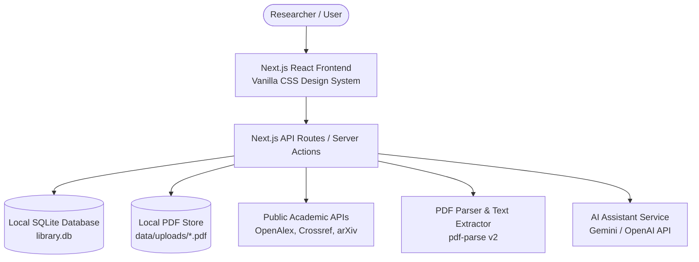
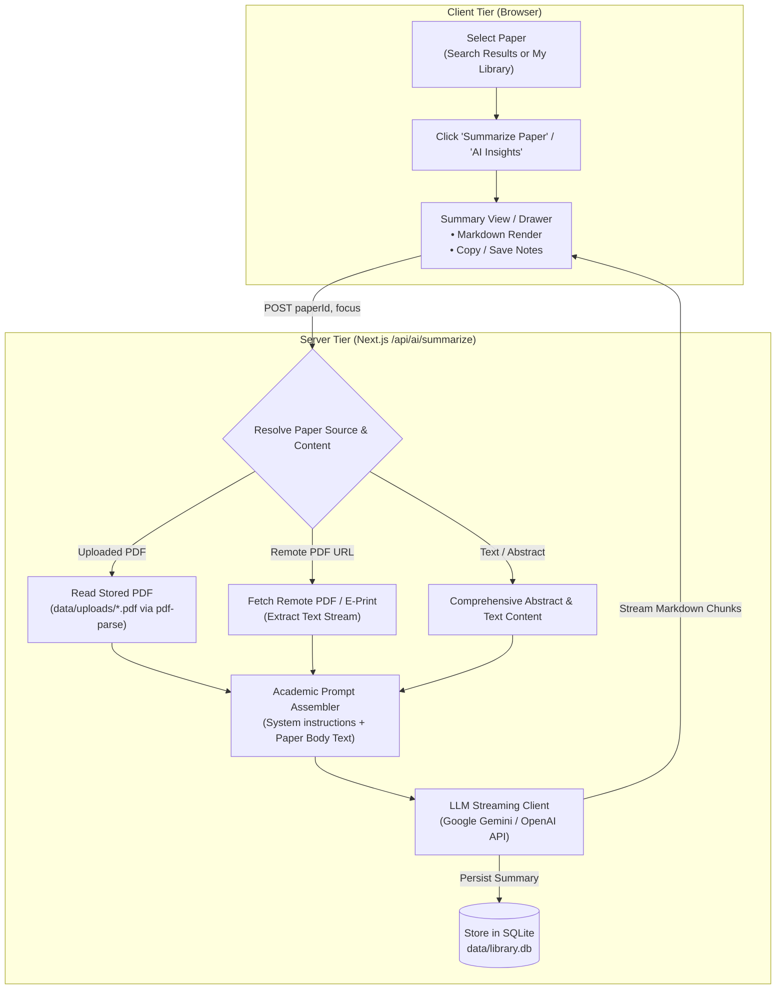

# AI Research Assistant — Executive Plan (Concise)

> **Quick Reference Guide for Researchers & Stakeholders**  
> *For in-depth architectural specifications, schemas, and AI execution steps, see [PLAN_DETAILED.md](file:///Users/rajeevgoyal/Codes/ASE/PLAN_DETAILED.md).*

---

## 1. Project Vision & Goals

The **AI Research Assistant** is a desktop-grade web application designed to streamline the academic research workflow:
1. **Search & Discover**: Query real-time academic literature (via OpenAlex, Crossref, and arXiv public APIs) with metadata like authors, publication year, abstracts, and direct PDF links.
2. **Curate & Persist**: Save papers into a local, offline-first library stored in SQLite that survives page reloads and application restarts, with individual and multi-select batch saving.
3. **Upload PDF Papers**: Upload research papers in PDF format and add them directly to the local database. Automatically extract the paper title, authors, publication year, and abstract so they render alongside searched papers and become searchable/organizable.
4. **Summarize Papers with an LLM (Current Task)**: Select any paper (uploaded PDF or search result) and prompt an LLM to generate a structured, comprehensive summary based on the actual paper content rather than only its title or metadata.
5. **Interactive Q&A & Comprehension**: Conduct conversational question-answering over paper content and clarify unfamiliar concepts.

---

## 2. Recommended Architecture & Tech Stack

### Why This Stack?

| Layer | Chosen Technology | Why We Chose It |
|---|---|---|
| **Full-Stack Framework** | **Next.js (App Router, TypeScript)** | Unified codebase for UI and API routes; eliminates CORS issues when calling external paper APIs; fast SSR and instant client updates. |
| **Styling** | **Vanilla CSS + CSS Modules** | Zero dependency bloat, maximum control, adhering to custom design tokens with high-contrast Dark Mode and Bright Mode toggles. |
| **Local Database** | **SQLite (via `better-sqlite3`)** | Zero configuration; embedded directly into a local file (`data/library.db`); instant queries, ACID compliant, persistent across restarts. |
| **PDF Extraction** | **`pdf-parse` v2 + Text Heuristics** | Robust parsing of academic PDF structures; reliably extracts titles, author blocks, publication years, and abstract sections from raw PDF text streams. |
| **Search Providers** | **OpenAlex + Crossref + arXiv API** | OpenAlex & Crossref provide 250M+ indexed works with exact conference/journal matching without rate limits; arXiv provides pre-prints. |
| **AI Engine** | **Google Gemini / OpenAI API** | High token context window suitable for ingesting full paper contents and PDFs; streaming support for real-time summaries. |

---

## 3. High-Level Feature Roadmap

```mermaid
gantt
    title Implementation Phases
    dateFormat  X
    axisFormat  Day %d
    section Phase 1
    Project Scaffolding & Design System (Done) :0, 1
    section Phase 2
    Paper Search Engine & Multi-Select Save (Done) :1, 2
    section Phase 3
    PDF Upload & Automated Metadata Extraction (Done) :2, 3
    section Phase 4
    Summarize Papers with an LLM (Current Focus) :3, 4
    section Phase 5
    Interactive Paper Q&A & Reading Tools :4, 5
    section Phase 6
    Polishing, Testing & Delivery :5, 6
```

### Phase Breakdown

1. **Phase 1: Project Setup & Design System** (Completed)
   - Initialized Next.js with TypeScript and Vanilla CSS Modules.
   - Built custom design system tokens (colors, gradients, glass cards, modern typography, bright/dark mode).

2. **Phase 2: Academic Search Engine & Multi-Select Save** (Completed)
   - Multi-provider search (OpenAlex + Crossref precision + arXiv fallback).
   - High-contrast readability for low laptop brightness + Bright Mode toggle.
   - Individual save and multi-select batch save to local SQLite database with persistence.
   - Abstract ranking (papers with abstracts prioritized; missing abstracts relegated to bottom).

3. **Phase 3: Upload PDF Papers & Metadata Extraction** (Completed)
   - Drag-and-drop and file-picker PDF uploader UI.
   - Server-side PDF text extraction using `pdf-parse` v2 (`PDFParse`).
   - Automated metadata extraction pipeline (Title, Authors, Publication Year, Abstract).
   - Saved binary to `data/uploads/` and recorded metadata into SQLite `papers` table.

4. **Phase 4: Summarize Papers with an LLM** (Current Focus)
   - **Selection**: User selects any paper from search results or the local library.
   - **Content Extraction Pipeline**:
     - For uploaded PDFs: read full paper text from `data/uploads/${fileId}.pdf`.
     - For online papers: fetch and parse PDF text if `pdfUrl` is available, or compile rich abstract + section contents.
   - **LLM Summary Generation**:
     - Prompt LLM with full paper text content (not just title/metadata).
     - Generate structured summaries: Objective & Problem, Methodology & Architecture, Key Findings, Limitations.
     - Real-time streaming response with markdown formatting.
   - **Persistence**: Store generated summaries in the SQLite database so they remain accessible offline.

5. **Phase 5: Interactive Paper Q&A & Reading Tools**
   - Conversational chat interface to ask questions about specific paper sections, tables, or equations.
   - Highlight unfamiliar terms to get beginner-friendly explanations.

6. **Phase 6: Hardening & End-to-End Validation**
   - Multi-format PDF stress testing (2-column IEEE, single-column Nature, large preprints).
   - Responsive polish and performance audit.

---

## 4. Architecture Diagram: Task 4 (LLM Paper Summarization)

---

## 5. Immediate Next Step

Proceed with **Phase 4: Summarize Papers with an LLM**.
